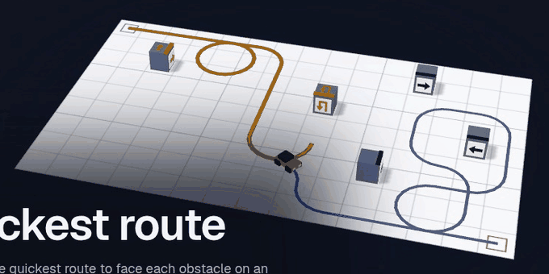
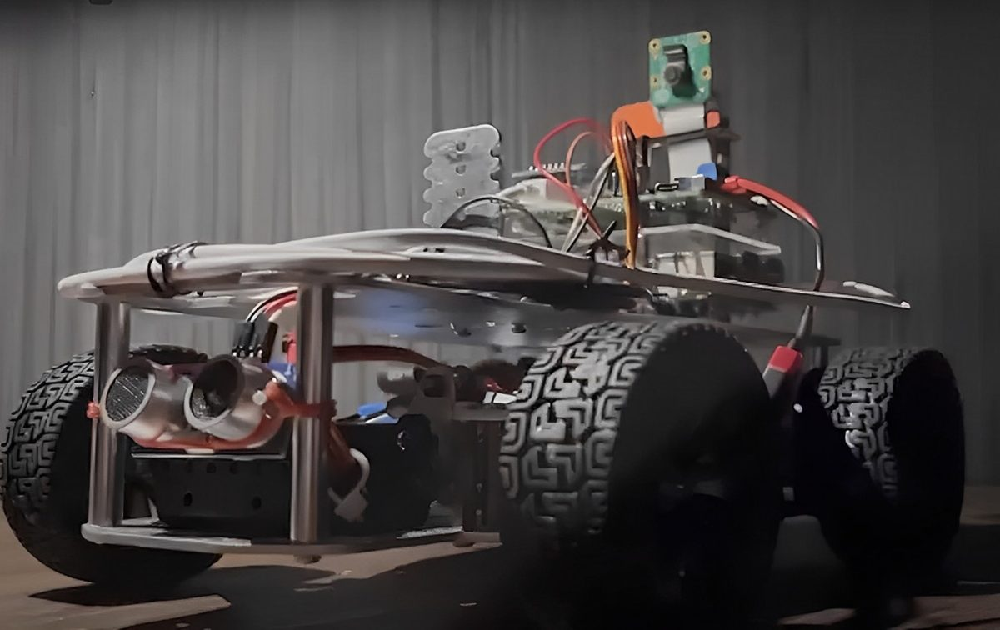
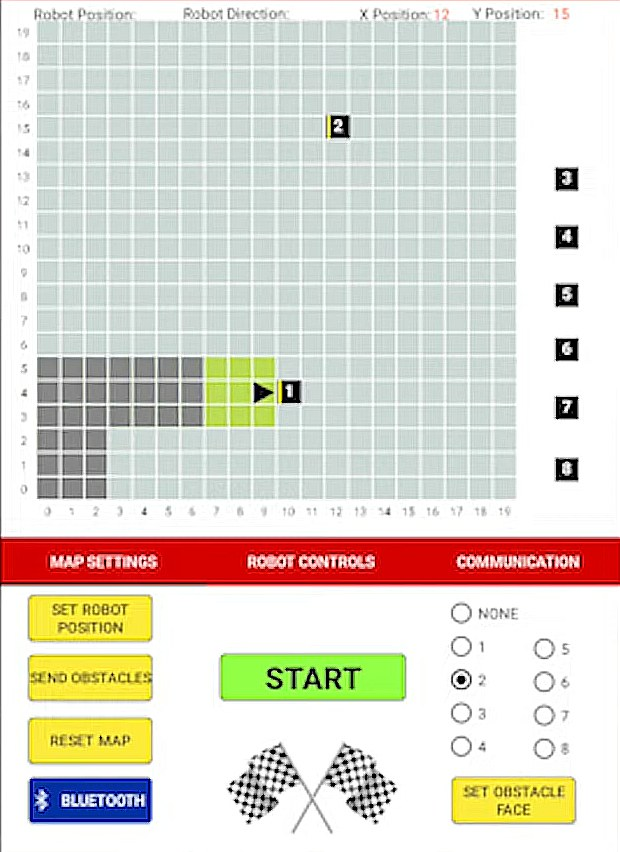

<h1>MDP Android: the remote for a self-navigating robot</h1>

<strong>The Android app for the robot car that ranked first of 47 teams 
in NTU's CZ3004 Multidisciplinary Design Project.</strong>

It connects to the robot over Bluetooth, lays out the obstacles on a map of the arena, 
starts the run, and shows where the robot is and which image it recognised on each obstacle.

    

  <a href="https://www.youtube.com/watch?v=gB2cBZrZiGE&t=232s"><strong>Watch the race</strong></a>
  &nbsp;&nbsp;|&nbsp;&nbsp;
  <a href="#what-the-app-does">What the app does</a>
  &nbsp;&nbsp;|&nbsp;&nbsp;
  <a href="#bluetooth-messages">Bluetooth messages</a>
  &nbsp;&nbsp;|&nbsp;&nbsp;
  <a href="#building-it">Build it</a>

How a run goes, as drawn on <a href="https://xitij27.vercel.app">my portfolio</a>: the planned route, then the car driving it and photographing each obstacle's symbol. A schematic: the layout and the planner are stand-ins. The real race is <a href="https://www.youtube.com/watch?v=gB2cBZrZiGE&t=232s">at 3:52 in the video</a>.

 

## The task

The arena is an open floor, and the robot knows the obstacles and where they
are. It has to work out the quickest way to face each obstacle, photograph the
side that carries a picture, and recognise the symbol on it. The symbol says
which way to go next: a right arrow means turn right. In that manner it reaches
the end point. The fastest team tops the leaderboard, and ours was the fastest
of 47 teams. The race is at
[3:52 to 4:11 of the video](https://www.youtube.com/watch?v=gB2cBZrZiGE&t=232s).

<table>
  <tr>
    <td width="58%" valign="top">
      
       The robot.
    </td>
    <td width="42%" valign="top">
      
       The app, on its Map Settings tab.
    </td>
  </tr>
</table>

## What the app does

The screen holds the arena, a 20 by 20 grid, above three tabs:
**Map Settings**, **Robot Controls** and **Communication**.

| No. | Task | Status |
|---|---|---|
| C.1 | The Android application (AA) is able to transmit and receive text strings over the Bluetooth serial communication link. | Done |
| C.2 | Functional graphical user interface (GUI) that is able to initiate the scanning, selection and connection with a Bluetooth device. | Done |
| C.3 | Functional GUI that provides interactive control of the robot movement via the Bluetooth link. | Done |
| C.4 | Functional GUI that shows remote update and status messages. | Done |
| C.5 | 2D display of the exploration arena with obstacles and the robot's location. | Done |
| C.6 | Interactive movement and placement of obstacles in map. | Done |
| C.7 | Interactive annotation of the face of the obstacle where the target image is located. | Done |
| C.8 | Robust connectivity with Bluetooth device. | Done |
| C.9 | Displaying Image Target ID on Obstacle Blocks in the Map. | Done |
| C.10 | Updating Position and Facing Direction of Robot in the Map. | Done |

## Bluetooth messages

Every message is plain text over the Bluetooth serial link
([`BluetoothConnectionService.java`](myApp/src/main/java/com/example/mdpgrp36/Bluetooth/BluetoothConnectionService.java)).

**The app sends**

| Message | When |
|---|---|
| `ALG\|x,y,F\|x,y,F…` | **Send Obstacles**: each obstacle on the map with its cell and the face its image is on (`N`, `E`, `S` or `W`) |
| `START` | **Start**: begin the run |
| `w`, `a`, `s`, `d`, `stop` | **Robot Controls**: forward, left, back, right, stop |
| `SUBOBSTACLE,id,x,y` | An obstacle dragged off the map, which goes back to the side |
| any text | Typed on the **Communication** tab |

**The app understands** (several messages can arrive in one string, separated by spaces;
[`ArenaMap.updateMap`](myApp/src/main/java/com/example/mdpgrp36/Arena/ArenaMap.java))

| Message | What the app does |
|---|---|
| `AND_IMG\|obstacleId,imageId` | Writes the recognised image's ID on that obstacle |
| `AND_PATH\|x,y,angle\|x,y,angle…` | Moves the robot through those cells. The angle is `0` east, `90` north, `180` west, `270` south |
| `MOVE\|w` (or `a`, `s`, `d`) | Moves the robot one step |

## Code layout

All the code is in [`myApp/src/main/java/com/example/mdpgrp36/`](myApp/src/main/java/com/example/mdpgrp36).

| Path | What it is |
|---|---|
| `MainActivity.java` | The screen: the arena above the tabs, and the handler for incoming messages |
| `MapSettingsFragment.java` | The Map Settings tab: robot position, obstacles, obstacle faces, Start |
| `Arena/` | `ArenaMap` draws the grid, the robot and the obstacles, and applies incoming messages. `Obstacle` is one obstacle |
| `Bluetooth/` | `BTConnectionPage` scans for a device, connects, and retries every 5 seconds if the link drops. `BluetoothConnectionService` holds the connection |
| `Controller/` | The Robot Controls tab |
| `Communication/` | The Communication tab: a chat log of what was sent and received |
| `Adapter/`, `Tab/` | The device list and the tab pager |

## Building it

Open the repository root in Android Studio. It is a Gradle project named
`MDP Group 36` with one module, `myApp` (application ID
`com.example.mdpgroup36`), built against Android SDK 30 and running on
Android 4.1 (SDK 16) and later.

> [!NOTE]
> The project was last built in 2022 with Android Gradle Plugin 3.6.3 and the Gradle 6.0 wrapper. A current Android Studio will likely ask to upgrade both before it builds.

## About this repository

This is my part of the work, the Android app, updated in Semester 1 of
AY2022/23. It isn't the team's original working repository: that one is
private, so I made this public one. I led the team of eight that built the
robot.

 

<a href="https://www.youtube.com/watch?v=gB2cBZrZiGE&t=232s">The race</a> &nbsp;|&nbsp; <a href="#what-the-app-does">What the app does</a> &nbsp;|&nbsp; <a href="#bluetooth-messages">Bluetooth messages</a> &nbsp;|&nbsp; <a href="https://xitij27.vercel.app">Portfolio</a>

